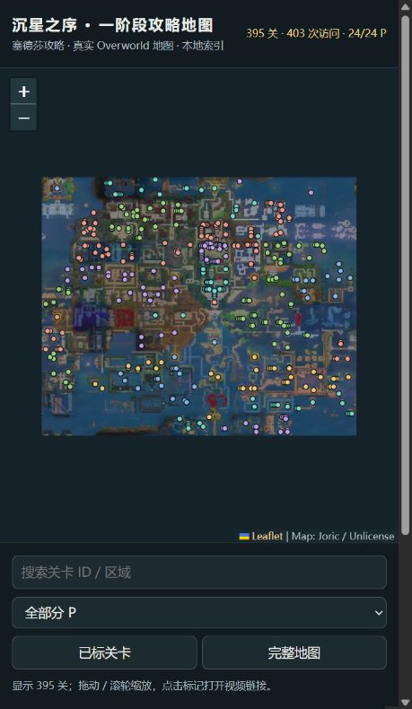

# 一阶段地图验收说明

直接打开 [互动大地图](index.html)，不用启动服务。地图是 Joric 的真实 Overworld 地形，可缩放、拖动、搜索关卡 ID / 区域、按分 P 筛选。点击地图标记或右侧列表，弹窗显示参考布局、视频区间和可点击的 B站时间链接；多次访问同一关会列出多个链接。右侧“视频处理覆盖情况”可查看各分 P 的处理状态。[CSV 明细](visits.csv) / [完整数据](index.json)。

## 收录范围

以塞德莎 `BV13FH96bE4m` 的实际视频为准。作者在 P25 标注“二阶段开始”，P45 标注“三阶段开始”，因此本次一阶段范围为 **P1–P24**，约 **15小时20分钟**。P1为前言、基础操作和地图介绍，没有独立关卡访问；其余23个分 P 都有审核记录。

当前共 **395个不同的 Overworld Level_Entry、403段访问记录**。坐标来自固定版本 Joric 数据，只有已对照画面的关卡才进入地图。目录中另有71个Overworld条目未在本次审核访问中出现，保存在 `index.json` 的 `not_observed` 中，不绘制标记；这表示“本次未观察到”，不据此宣称游戏设计上不属于一阶段。未用全部466个入口冒充一阶段列表。

大型关卡内可能有多个通过箭头相连的房间；本次以 **Overworld入口对应的Level_Entry** 为索引单位。内部子房间不额外杜撰地表坐标，也不宣称每个内部房间都与入口参考图一致。P6、P8、P9、P18、P22均结合连续图册和局部高清帧检查过这种情况。P24的end1多次出现合并为同一个地图点，保留5段可跳转区间。

## 各分 P

| 分 P | 不同入口 | 访问记录 | 作者标题 |
|---|---|---|---|
| [P01](../p1/index.html) | 0 | 0 | 前言【务必观看】和基础操作教学 |
| [P02](../p2/index.html) | 20 | 21 | 【北】搬运英雄[北1缺1题/北2] |
| [P03](../p3/index.html) | 30 | 30 | 【北】英雄2：怪物[北3] |
| [P04](../p4/index.html) | 29 | 29 | 【北】英雄3：吟游诗人与德鲁伊+能量门方向+英雄齐聚[北4+北3西1+北1补1题] |
| [P05](../p5/index.html) | 27 | 30 | 【东】镜之群岛[东1/东2/北1东2/北1东1/南1东3/南1东2] |
| [P06](../p6/index.html) | 1 | 1 | 【南】飞石成径[南1全6宝藏] |
| [P07](../p7/index.html) | 3 | 3 | 【南】飞石成径[南2/南4] |
| [P08](../p8/index.html) | 2 | 2 | 【西】光束发射器之库[西1/西2] |
| [P09](../p9/index.html) | 10 | 10 | 【西】推车与短杖+项环[北1西2/北1西1+南1西2/南1西1] |
| [P10](../p10/index.html) | 29 | 29 | 【东北】黄金谜题&英雄与水[北2东1/北3东1/北4东1缺1题/北5东2/北4东2] |
| [P11](../p11/index.html) | 20 | 20 | 【东北】英雄与魔镜[北3东2/北3东3/北2东2] |
| [P12](../p12/index.html) | 14 | 14 | 【东北】英雄与魔镜[北2东3/北1东3/北1东4/北2东4] |
| [P13](../p13/index.html) | 28 | 28 | 【东南】黄金谜题+魔镜与飞石[南2东1/南3东1/南3东2/南2东2/南3东3/南3东4] |
| [P14](../p14/index.html) | 16 | 16 | 【东南】魔镜与飞石[南4东4/南4东1/南4东2/南4东3] |
| [P15](../p15/index.html) | 16 | 16 | 【西北】黄金谜题+英雄与神器[北2西1+北2西2/北1西3/北2西3/北2西4/北2西5] |
| [P16](../p16/index.html) | 27 | 27 | 【西北】英雄与光[北3西2/北3西3/北3西4/北4西4/北5西4] |
| [P17](../p17/index.html) | 29 | 29 | 【西北】英雄与光：进阶[北4西3/北5西3/北4西2/北5西1/北4西1/北5西2] |
| [P18](../p18/index.html) | 15 | 15 | 【西南】黄金谜题+光照之石[南2西1/南3西1/南4西1/南3西2/南3西3] |
| [P19](../p19/index.html) | 9 | 9 | 【西南】光照之石[南2西2/南2西3/南3西4] |
| [P20](../p20/index.html) | 27 | 27 | 【南北】黄金谜题+英雄与水：北部+英雄与飞石：西部[北6+北5东1/北4东1补1题+北6西1/南5西1/南5左半/北6西2/北6西3] |
| [P21](../p21/index.html) | 15 | 15 | 【南北】英雄与飞石：东部[南5右半/南5东1/南5东2/北6东1/北6东3] |
| [P22](../p22/index.html) | 14 | 14 | 【东西】黄金谜题+反射光束[西5+南1西5/南1东4/南2东4] |
| [P23](../p23/index.html) | 13 | 13 | 【东西】映照之光+反射光束[北1西5缺2题+南2西5/南3西5] |
| [P24](../p24/index.html) | 1 | 5 | 【结局1】对映之地+出口[北6西5+北5西5] |

## 依据与限制

- 5秒低分辨率图册用于检索与查漏；8fps黑场扫描辅助边界。机器候选与 `reviewed.json` 分开，候选分数不是概率，重跑不会自动覆盖审核。Luna协助逐项布局对照和长空档审计，根Agent处理连续滚屏、世界入口及结果汇总。
- 共403段记录的身份经画面对照后收录。P4原有13个入口及P8首个入口另有独立地形/入口格对照，共14段；16段明确无主世界画面，其余373段没有独立验证进入前的地形。地图点来自身份对应的上游坐标，不等于这403次进入动作都在世界画面中逐次核实。
- 247段时间边界标注约±0.5秒，155段约±5秒，另1段约±2.5秒；这是逐条记录的采样估计，不是统计测得的精度。链接跳到开始时间的整数秒，可先看到少量转场画面。部分离开时间只以最后可确认画面界定，具体参看各分P的 `reviewed.json`。
- `outcome`均保持unknown；当前索引确认访问与身份，未逐项核实通关/跳过。没有独立盲测真值，不声称100%召回，也不能排除短于采样间隔、又缺少显著转场的画面被漏掉。
- 审计修正了P9的beam_rooms截尾和gem_pushers拆分、P15的cleric_isles截尾、P18的长访问范围，以及P22的protrusions/mirror_promesst长空档。初始参考只对应起始房间时，理由明确限定证据范围。

每个分P都有 `reviewed.json`、`index.json/csv/md/html` 和真实地形 `map.svg/png`；`evidence/`保留紧凑对照图册，详细抽帧和补查包在本地 `runs/pN/`。全部证据路径已检查存在，审核时间区间无重叠。P4原有身份审核不变，只更新显示背景与导航。

## 下载与复现

全系列 **68/68个分P已下载完成**，共约43小时57分钟、6.21GiB；按一/二/三阶段目录及P编号整理，保留原题名。最高480p并保留音频，P4复用用户原视频。每个成品均用ffprobe核验分P时长，允许与整数元数据相差3秒。失败线路通过公开playurl的备用CDN恢复，仍由yt-dlp下载、FFmpeg流复制合并，无需登录凭证。[完整下载清单](../series/inventory.md) / [下载台账](../series/manifest.json)。

```powershell
# 项目根目录；已有缓存均复用
.\ootss.ps1 series          # 缺失下载续传，重新检查成品
.\ootss.ps1 atlas           # 从各分P审核结果重建大地图
# 单个分P重新导出
.\ootss.ps1 export --review results/p22/reviewed.json --out results/p22
```

本次没有调用付费模型API或上传整段视频。原视频、下载详情、参考图及抽帧缓存不进入Git；源代码、紧凑证据与导出结果已本地提交。界面是可复制的静态文件，不需要运行分析网站或后台服务。

地图数据固定于 `joric/ootss` commit `4ff82651f7af3859a16ebce6197fe363ac40d9a1`，Joric / Unlicense。底图/参考素材来自 `joric.github.io/ootss_tileset`，P4素材另有固定资源版本SHA核验；没有把该核验扩称为本次所有素材都已逐一比对固定远端。Leaflet 1.9.4使用BSD许可证，副本在assets中。0–3级基础瓦片随文件保存，更高倍率在线加载。代码12项本地测试与Ruff通过；浏览器通过本地HTTP预览已核对筛选、定位、参考图显示、时间链接和窄窗口布局。内置浏览器策略只允许HTTP/HTTPS，未能实测file协议；直接打开文件的实现不使用本地JSON请求，数据/脚本/样式及基础瓦片均在交付目录内。


## 界面预览



[单关参考布局与时间跳转的实际预览](preview-level.png)。
